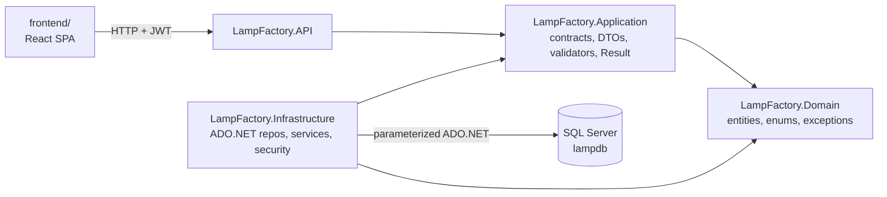

# Lamp Factory

Backend and frontend for an **SKD LED-lamp factory management system** — a
production ERP covering the full SKD (semi-knock-down) flow: master data,
warehouses and stock, bills of materials, production planning, production
documents with operator assignments, purchasing / request / sales / charge
vouchers, quality control, read-side reports, and role-based access with audit
stamps.

## The business problem

An SKD lamp factory assembles finished lamps from purchased components. The
system must answer, per product and warehouse: what is in stock, which bills
of materials describe how to assemble it, what was planned and produced on
which line and shift, which operators staffed each production document, where
materials were requested from stock, and what was purchased, sold, or charged
back into inventory — with every change attributed to a user and business
endpoints protected by JWT authentication plus per-resource permission
checks. The application implements those flows end to end (verified against
the 96 documented API actions) with a React client for operators and a .NET 10
API with a raw ADO.NET persistence layer.


*Login page of the running React client, captured from the local development
build (no real credentials involved).*

## Implemented features (verified from source)

- **Master data:** products (final/component types), warehouses
  (entry-storage/final), operators, production lines.
- **BOMs** with component consumption amounts; production plans with product
  quantity ranges and priorities; production documents with shift, produced /
  rejected quantities and operator assignments; line stops.
- **Voucher flow** with transactional stock effects: purchase (stock in),
  request (validated stock out), sales (validated stock out), charge
  (production goods into stock), each with header + product lines.
- **Quality control** records per production document.
- **Reports:** production traceability and material-consumption variance,
  both filterable.
- **Security:** JWT login + single-use refresh-token rotation with reuse
  detection, permission checks per resource/action, server-side audit stamps.
- **Audit log:** last action (Created/Modified) per entity across 17 entity
  types, paged and filterable.

## Technology stack (versions from the project files)

| Component | Technology | Version |
|---|---|---|
| Backend runtime | .NET (SDK pinned) | `10.0.401` (`global.json`) |
| API framework | ASP.NET Core (controllers) | net10.0 |
| Data access | ADO.NET / Microsoft.Data.SqlClient | `7.0.2` |
| Validation | FluentValidation.DependencyInjectionExtensions | `12.1.1` |
| Auth | Microsoft.AspNetCore.Authentication.JwtBearer | `10.0.10` |
| API docs | Microsoft.AspNetCore.OpenApi + Scalar.AspNetCore | `10.0.11` / `2.16.18` |
| Frontend | React + Vite + Tailwind | React `18.3.1`, Vite `5.4.8`, Tailwind `3.4.13` |
| Routing / HTTP client | react-router-dom, axios, jwt-decode | `6.26.2`, `1.7.7`, `4.0.0` |
| Tests | xunit + NSubstitute + Mvc.Testing | `2.9.3`, `5.3.0`, `10.0.10` |

## Architecture overview

Four production projects with a strictly inward-pointing dependency rule
(`Domain` → nothing; `Application` → `Domain`; `Infrastructure` →
`Application`+`Domain`; `API` → `Application`+`Infrastructure`). Contracts
(services, repositories, security) live in Application; their concrete
implementations (ADO.NET repositories, 22 services, JWT, current-user) live in
Infrastructure. Details, diagrams, and the request flow:
[docs/architecture.md](docs/architecture.md).



## Documentation

| Document | Contents |
|---|---|
| [docs/architecture.md](docs/architecture.md) | Layers, dependency graph, request flow, Result→HTTP mapping, transactions |
| [docs/database.md](docs/database.md) | Schema script, repository pattern, header-detail writes, inventory semantics |
| [docs/api.md](docs/api.md) | Full endpoint reference — 96 actions, envelope contract, examples |
| [docs/security.md](docs/security.md) | JWT, permissions, audit identity, secrets — and verified weaknesses |
| [docs/development.md](docs/development.md) | Setup, secrets, run/build/test commands, troubleshooting |
| [docs/testing.md](docs/testing.md) | The 4 test projects, DB dependency, observed results |
| [docs/frontend.md](docs/frontend.md) | React client structure, auth flow, API connection, commands |

## Prerequisites

- .NET SDK **10.0.401** (pinned by `global.json`).
- A reachable SQL Server instance (LocalDB/Express/Developer).
- Node.js for the frontend — **not pinned** by the project (no `engines`
  field); npm with the committed `package-lock.json`.

## Database setup

```bash
sqlcmd -S localhost -E -i database/lamp-factory.sql
```

Creates `lampdb` and its 29 tables. **The script inserts no seed data** —
bootstrapping the first administrative user is currently a manual step; see
[docs/database.md](docs/database.md#setup-gaps-verified). The default
connection string uses Windows authentication against `localhost` and can be
overridden locally.

## Configure local secrets (never commit real values)

`Jwt:Key` is committed **empty** on purpose. Supply it locally:

```bash
cd src/LampFactory.API
dotnet user-secrets set "Jwt:Key" "<your-own-32+-byte-signing-key>"
# optional: dotnet user-secrets set "ConnectionStrings:DefaultConnection" "…"
```

Backend keys: `Jwt:Key`, `Jwt:Issuer`, `Jwt:Audience`,
`ConnectionStrings:DefaultConnection`. Without `Jwt:Key` every request —
including the docs UI — answers 500 (verified). Details:
[docs/development.md](docs/development.md#2-configure-the-jwt-signing-key).

## Build, run, test

```bash
# backend
dotnet build "Lamp Factory.slnx"
dotnet run --project src/LampFactory.API/LampFactory.API.csproj     # http://localhost:5259
dotnet test "Lamp Factory.slnx"                                      # observed: 62/62 passing

# frontend
cd frontend
npm ci
cp .env.example .env          # set VITE_API_BASE_URL, e.g. https://localhost:7263/api
npm run dev                   # http://localhost:5173 (the CORS-allowed origin)
```

In Development the OpenAPI document is served at `/openapi/v1.json` and the
**Scalar UI at `/scalar`** (verified against a running instance); both are
disabled outside Development.


## License

This project is licensed under the MIT License.
See the [LICENSE](LICENSE) file for details.