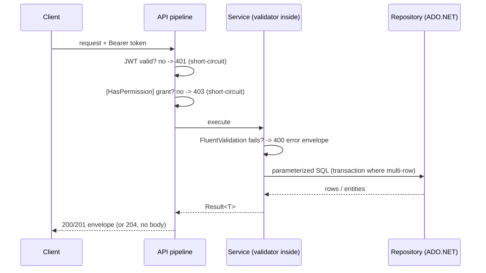

?# API Reference

Derived from the 22 controllers in `src/LampFactory.API/Controllers/**`, the
DTOs in `src/LampFactory.Application/Features/**`, and cross-checked against
the live OpenAPI document. Every action appears as its own row — nothing is
hidden behind a CRUD shorthand.

**Counts, labeled precisely (each verified in its own dimension):**

| Count | Value | How verified |
|---|---|---|
| HTTP action methods | **96** | count of `[Http*]` attributes in controller source |
| Unique route templates | **43** | `openapi/v1.json` `paths` entries |
| OpenAPI operations | **96** | method entries across all path templates |
| Controllers / module groups | 22 / 9 | controller files / folder structure |

Source count and live OpenAPI agree (96 = 96). Route templates are fewer than
actions because collection routes (`/api/Product`) host the GET + POST pair
and item routes (`/api/Product/{id}`) host the GET + PUT + DELETE set.

- **Base URL (local dev):** `https://localhost:7263/api` or `http://localhost:5259/api`
  (`Properties/launchSettings.json`).
- **Interactive docs (Development only):** OpenAPI JSON at `/openapi/v1.json`,
  Scalar UI at `/scalar`.

## Module index

Nine module groups (= the `Controllers/` folder layout) covering all 22
controllers; each link jumps to that controller's reference table:

| Module group | Sections |
|---|---|
| Audit | [AuditLog](#audit-auditlogcontroller) |
| IdentityAccess | [Auth](#auth-authcontroller-anonymous) ([anonymous](#access-levels)) · [Permission](#permission-permissioncontroller) · [Resource](#resource-resourcecontroller) · [Role](#role-rolecontroller) · [SysAction](#sysaction-sysactioncontroller) · [User](#user-usercontroller) |
| Inventory | [Product](#product-productcontroller) · [Warehouse](#warehouse-warehousecontroller) |
| Production | [BOM](#bom-bomcontroller) · [LineStop](#linestop-linestopcontroller) · [Operator](#operator-operatorcontroller) · [ProductionDocument](#productiondocument-productiondocumentcontroller) · [ProductionLine](#productionline-productionlinecontroller) · [ProductionPlan](#productionplan-productionplancontroller) |
| Purchasing | [PurchaseVoucher](#purchasevoucher-purchasevouchercontroller) · [RequestVoucher](#requestvoucher-requestvouchercontroller) |
| QualityControl | [QualityControl](#qualitycontrol-qualitycontrolcontroller) |
| Reports | [two read-only report controllers](#reports-two-read-only-controllers) |
| Sales | [SalesVoucher](#salesvoucher-salesvouchercontroller) |
| Vouchers | [ChargeVoucher](#chargevoucher-chargevouchercontroller) |

Reference sections above: [Response conventions](#response-conventions) ·
[Representative examples](#representative-examples).

## Response conventions

All actions except `AuthController`'s two return the envelope built by
`API/Common/ResultMappingExtensions.cs`. No custom JSON options are configured,
so the default `System.Text.Json` behavior applies — **camelCase on the wire
for outgoing JSON, case-insensitive binding for incoming bodies**.

```json
{
  "isSuccess": true,
  "statusCode": 200,
  "errorMessage": null,
  "result": { }
}
```

Two distinct status values exist and must not be conflated:

- the **HTTP transport status** of the response, and
- the **`statusCode` field inside the envelope**, which the mapping code sets
  to `HttpStatusCode.OK` for every success envelope and to the mapped error
  status for failure envelopes. A 201-created response therefore carries
  HTTP 201 with an inner `statusCode` of 200.

### Access levels

| Level | Where |
|---|---|
| **Anonymous** | `POST /api/Auth/login`, `POST /api/Auth/refresh` only |
| **Authenticated, no permission requirement** | `GET /api/Resource/my-accessible` (and everything above) |
| **Authenticated + `[HasPermission(resource, action)]`** | all remaining actions |

`[Authorize]` plus the JWT handler produce **401** for a missing/invalid
token; the `PermissionAuthorizationFilter` produces **401** when the principal
has no resolvable user id and **403** (`ForbidResult`) when the permission
check fails. Parameter notation: a `—` in the request column means the action
has **no body** (note that GET/DELETE never read a body; the `{id}` comes from
the route).

### Status codes

| Status | Meaning | Body |
|---|---|---|
| 200 | success | success envelope (inner `statusCode` 200) |
| 201 | created; `Location` header only where stated | success envelope |
| 204 | delete succeeded | **none — no body at all** |
| 400 | validation failure, or refresh without token | error envelope, or plain string for refresh |
| 401 | missing/invalid token, bad credentials, rejected refresh | 401 challenge, envelope, or `{ "message": … }` |
| 403 | authenticated but permission missing | `ForbidResult` → empty body (bearer challenge) |
| 404 | `ErrorType.NotFound` / `NotFoundException` | error envelope |
| 409 | `ErrorType.Conflict` / `ConflictException` | error envelope |
| 500 | unhandled exception (incl. `InsufficientStockException`) | fixed message "An unexpected error occurred." — envelope |

Error envelope (`errorMessage` is a list; validation puts every rule there):

```json
{ "isSuccess": false, "statusCode": 404,
  "errorMessage": ["BOM not found for deletion."], "result": null }
```

**Auth responses deviate on purpose** (verified in `AuthController` + live):

| Case | Status | Body |
|---|---|---|
| login OK / refresh OK | 200 | `AuthResponseDTO` **directly** — `{ "accessToken": "<jwt>", "refreshToken": "<opaque>" }`, not the envelope |
| bad credentials | 401 | `{ "message": "Incorrect username or password." }` |
| refresh without token | 400 | plain string `"Refresh Token is not sent."` |
| refresh expired/unknown/reused | 401 | `{ "message": "<reason>" }` |

**Enums serialize as numbers** (`ProductType`: Final=0, Component=1;
`WarehouseType`: EntryStorage=0, FinalWarehouse=1; `QualityControlType`:
Final=0, Period=1).

### Authenticated request at a glance



The failure paths above short-circuit: an invalid token or a missing grant
never reaches a controller or business logic; a validation failure never
reaches a repository.

---

## Audit (`AuditLogController`)
| Method | Route | Auth / Permission | Request | Success | `result` payload |
|---|---|---|---|---|---|
| GET | `/api/AuditLog` | Bearer + `AuditLog:Read` | query: `entityName`, `page`, `pageSize` (all optional) | 200 | paged audit rows (`object`) |
| GET | `/api/AuditLog/entities` | Bearer + `AuditLog:Read` | — (no body) | 200 | `List<string>` — auditable entity names |

Audit rows come from a SQL `UNION ALL` across 17 entity tables and expose
`entityName`, `entityID`, `entityLabel`, `lastAction`, `lastAt`, `lastBy`,
`lastByUsername` plus the created/modified audit columns.

## Auth (`AuthController`, anonymous)
| Method | Route | Auth / Permission | Request | Success | `result` payload |
|---|---|---|---|---|---|
| POST | `/api/Auth/login` | **anonymous** | `LoginDTO` `{ username, password }` | 200 | `AuthResponseDTO` directly (see auth exceptions) |
| POST | `/api/Auth/refresh` | **anonymous** | `RefreshRequestDTO` `{ refreshToken }` | 200 | `AuthResponseDTO` directly (see auth exceptions) |

## Permission (`PermissionController`)
| Method | Route | Auth / Permission | Request | Success | `result` payload |
|---|---|---|---|---|---|
| GET | `/api/Permission` | `Permission:Read` | — (no body) | 200 | `List<PermissionDTO>` |
| GET | `/api/Permission/{id}` | `Permission:Read` | — (no body) | 200 | `PermissionDTO` |
| POST | `/api/Permission` | `Permission:Create` | `PermissionCreateDTO` `{ resourceID, actionID }` | 201 + `Location` → `GetById` | `PermissionDTO` |
| PUT | `/api/Permission/{id}` | `Permission:Update` | `PermissionCreateDTO` | 200 | `string` message |
| DELETE | `/api/Permission/{id}` | `Permission:Delete` | — (no body) | **204 no body** | — |

## Resource (`ResourceController`)
| Method | Route | Auth / Permission | Request | Success | `result` payload |
|---|---|---|---|---|---|
| GET | `/api/Resource` | `Resource:Read` | — (no body) | 200 | `List<Resource>` |
| GET | `/api/Resource/my-accessible` | **Bearer only — no permission attribute** | — (no body) | 200 | `List<ResourceDTO>` |
| GET | `/api/Resource/{id}` | `Resource:Read` | — (no body) | 200 | `Resource` |
| POST | `/api/Resource` | `Resource:Create` | `ResourceDetailsDTO` `{ resource: { name } }` | 201 + `Location` → `GetById` | `Resource` |
| PUT | `/api/Resource/{id}` | `Resource:Update` | `ResourceDetailsDTO` | 200 | `Resource` |
| DELETE | `/api/Resource/{id}` | `Resource:Delete` | — (no body) | **204 no body** | — |

## Role (`RoleController`)
Note: this controller has **no `GET /api/Role/{id}` action** — the only read
is the collection endpoint (verified in source and in the OpenAPI list).

| Method | Route | Auth / Permission | Request | Success | `result` payload |
|---|---|---|---|---|---|
| GET | `/api/Role` | `Role:Read` | — (no body) | 200 | `List<RoleDetailDTO>` |
| POST | `/api/Role` | `Role:Create` | `RoleCreateDTO` `{ roleName, description, permissionIds[] }` | 201 (no `Location`) | `RoleDetailDTO` |
| PUT | `/api/Role/{id}` | `Role:Update` | `RoleUpdateDTO` (same shape) | 200 | `string` message |
| DELETE | `/api/Role/{id}` | `Role:Delete` | — (no body) | **204 no body** | — |

## SysAction (`SysActionController`)
| Method | Route | Auth / Permission | Request | Success | `result` payload |
|---|---|---|---|---|---|
| GET | `/api/SysAction` | `SysAction:Read` | — (no body) | 200 | `List<SysAction>` |
| GET | `/api/SysAction/{id}` | `SysAction:Read` | — (no body) | 200 | `SysAction` |
| POST | `/api/SysAction` | `SysAction:Create` | `SysActionDTO` `{ sysAction: { name } }` | 201 + `Location` → `GetById` | `SysAction` |
| PUT | `/api/SysAction/{id}` | `SysAction:Update` | `SysActionDTO` | 200 | `SysAction` |
| DELETE | `/api/SysAction/{id}` | `SysAction:Delete` | — (no body) | **204 no body** | — |

## User (`UserController`)
| Method | Route | Auth / Permission | Request | Success | `result` payload |
|---|---|---|---|---|---|
| GET | `/api/User` | `SystemUser:Read` | — (no body) | 200 | `List<UserRolesDTO>` |
| GET | `/api/User/{id}` | `SystemUser:Read` | — (no body) | 200 | `UserRolesDTO` |
| POST | `/api/User` | `SystemUser:Create` | `UserRolesDTO` `{ user: {…}, roleIds[] }` | 201 + `Location` → `GetById` | `UserRolesDTO` |
| PUT | `/api/User/{id}` | `SystemUser:Update` | `UserRolesDTO` | 200 | `UserRolesDTO` |
| DELETE | `/api/User/{id}` | `SystemUser:Delete` | — (no body) | **204 no body** | — |

`user` embeds the raw `User` entity (`userID`, `username`, `userpass`,
`fullname`, `phone` + audit columns) — `userpass` is present in responses
(security finding, see [security.md](security.md#password-storage-verified-trace)).

## Product (`ProductController`)
| Method | Route | Auth / Permission | Request | Success | `result` payload |
|---|---|---|---|---|---|
| GET | `/api/Product` | `Product:Read` | — (no body) | 200 | `List<Product>` |
| GET | `/api/Product/{id}` | `Product:Read` | — (no body) | 200 | `Product` |
| POST | `/api/Product` | `Product:Create` | `ProductDTO` `{ product: {…} }` | 201 + `Location` → `GetById` | `Product` |
| PUT | `/api/Product/{id}` | `Product:Update` | `ProductDTO` | 200 | `Product` |
| DELETE | `/api/Product/{id}` | `Product:Delete` | — (no body) | **204 no body** | — |

`Product` fields: `productID`, `productType` (0/1), `productColor`,
`material`, `standardNumber`, `weight`, `voltage`, `power`, `lampholderType`,
`consumptionUnit` + audit columns.

## Warehouse (`WarehouseController`)
| Method | Route | Auth / Permission | Request | Success | `result` payload |
|---|---|---|---|---|---|
| GET | `/api/Warehouse` | `Warehouse:Read` | — (no body) | 200 | `List<WarehouseDetailsDTO>` (each with stock rows) |
| GET | `/api/Warehouse/{id}` | `Warehouse:Read` | — (no body) | 200 | `WarehouseDetailsDTO` |
| POST | `/api/Warehouse` | `Warehouse:Create` | `WarehouseDetailsDTO` | 201 + `Location` → `GetById` | `WarehouseDetailsDTO` |
| PUT | `/api/Warehouse/{id}` | `Warehouse:Update` | `WarehouseDetailsDTO` | 200 | `WarehouseDetailsDTO` |
| DELETE | `/api/Warehouse/{id}` | `Warehouse:Delete` | — (no body) | **204 no body** | — |

`WarehouseDetailsDTO` = `warehouse` header (`warehouseID`, `warehouseType`
0/1, `name`, `address` + audit columns) + `products[]` of `WarehouseProduct`
(`warehouseID`, `productID`, `quantity`).

## BOM (`BOMController`)
| Method | Route | Auth / Permission | Request | Success | `result` payload |
|---|---|---|---|---|---|
| GET | `/api/BOM` | `BOM:Read` | — (no body) | 200 | `List<BOMWithComponentsDTO>` |
| GET | `/api/BOM/{id}` | `BOM:Read` | — (no body) | 200 | `BOMWithComponentsDTO` |
| POST | `/api/BOM` | `BOM:Create` | `BOMDTO` `{ bom, components[] }` | 201 + `Location` → `GetById` | `BOMWithComponentsDTO` |
| PUT | `/api/BOM/{id}` | `BOM:Update` | `BOMDTO` | 200 | `BOMWithComponentsDTO` |
| DELETE | `/api/BOM/{id}` | `BOM:Delete` | — (no body) | **204 no body** | — |

Read shape uses `bomId`; write DTO uses the entity field `bOM_ID`
(`{ "bom": { "bOM_ID": 0, "productID": 5 }, "components": [ { "consumptionAmount": 2.5,
"bOM_ID": 0, "productID": 11 } ] }`).

## LineStop (`LineStopController`)
| Method | Route | Auth / Permission | Request | Success | `result` payload |
|---|---|---|---|---|---|
| GET | `/api/LineStop` | `LineStop:Read` | — (no body) | 200 | `List<LineStop>` |
| GET | `/api/LineStop/{id}` | `LineStop:Read` | — (no body) | 200 | `LineStop` |
| POST | `/api/LineStop` | `LineStop:Create` | `LineStopDTO` `lineStop` | 201 + `Location` → `GetById` | `LineStop` |
| PUT | `/api/LineStop/{id}` | `LineStop:Update` | `LineStopDTO` | 200 | `LineStop` |
| DELETE | `/api/LineStop/{id}` | `LineStop:Delete` | — (no body) | **204 no body** | — |

`LineStop` fields: `lineStopID`, `lineStopDate`, `reason`,
`productionDocumentID` + audit columns.

## Operator (`OperatorController`)
| Method | Route | Auth / Permission | Request | Success | `result` payload |
|---|---|---|---|---|---|
| GET | `/api/Operator` | `Operator:Read` | — (no body) | 200 | `List<Operator>` |
| GET | `/api/Operator/{id}` | `Operator:Read` | — (no body) | 200 | `Operator` |
| POST | `/api/Operator` | `Operator:Create` | `OperatorDTO` `operator` | 201 + `Location` → `GetById` | `Operator` |
| PUT | `/api/Operator/{id}` | `Operator:Update` | `OperatorDTO` | 200 | `Operator` |
| DELETE | `/api/Operator/{id}` | `Operator:Delete` | — (no body) | **204 no body** | — |

`Operator` fields: `operatorID`, `nationalID`, `firstName`, `lastName`,
`hiringDate` + audit columns.

## ProductionDocument (`ProductionDocumentController`)
| Method | Route | Auth / Permission | Request | Success | `result` payload |
|---|---|---|---|---|---|
| GET | `/api/ProductionDocument` | `ProductionDocument:Read` | — (no body) | 200 | **generic `object`** — document aggregates (header + operators) |
| GET | `/api/ProductionDocument/{id}` | `ProductionDocument:Read` | — (no body) | 200 | **generic `object`** — single aggregate |
| POST | `/api/ProductionDocument` | `ProductionDocument:Create` | `ProductionDocumentDTO` | 201 (no `Location`) | **generic `object`** |
| PUT | `/api/ProductionDocument/{id}` | `ProductionDocument:Update` | `ProductionDocumentDTO` | 200 | `ProductionDocumentDTO` |
| DELETE | `/api/ProductionDocument/{id}` | `ProductionDocument:Delete` | — (no body) | **204 no body** | — |

The GET/POST `object` typing is the controller's declared return type — the
concrete aggregate shape is produced by the service; read shape shown in the
example below reflects the DTO used for writes.

`ProductionDocumentDTO` = `productionDocument` (`productionDocumentID`,
`productionDate`, `producedQuantity`, `rejectedQuantity`, `productionShift`,
`productionPlanID`, `productID`, `productionLineID` + audit columns) +
`operators[]` of `ProductionDocumentOperator` (`operatorRole`,
`assignedDateFrom`, `assignedDateUntil`, `productionDocumentID`,
`operatorID`).

## ProductionLine (`ProductionLineController`)
| Method | Route | Auth / Permission | Request | Success | `result` payload |
|---|---|---|---|---|---|
| GET | `/api/ProductionLine` | `ProductionLine:Read` | — (no body) | 200 | `List<ProductionLine>` |
| GET | `/api/ProductionLine/{id}` | `ProductionLine:Read` | — (no body) | 200 | `ProductionLine` |
| POST | `/api/ProductionLine` | `ProductionLine:Create` | `ProductionLineDTO` `productionLine` | 201 + `Location` → `GetById` | `ProductionLine` |
| PUT | `/api/ProductionLine/{id}` | `ProductionLine:Update` | `ProductionLineDTO` | 200 | `ProductionLine` |
| DELETE | `/api/ProductionLine/{id}` | `ProductionLine:Delete` | — (no body) | **204 no body** | — |

`ProductionLine` fields: `productionLineID`, `status` (bool) + audit columns.

## ProductionPlan (`ProductionPlanController`)
| Method | Route | Auth / Permission | Request | Success | `result` payload |
|---|---|---|---|---|---|
| GET | `/api/ProductionPlan` | `ProductionPlan:Read` | — (no body) | 200 | **generic `object`** — plan aggregates (header + products) |
| GET | `/api/ProductionPlan/{id}` | `ProductionPlan:Read` | — (no body) | 200 | **generic `object`** — single aggregate |
| POST | `/api/ProductionPlan` | `ProductionPlan:Create` | `ProductionPlanDTO` | 201 (no `Location`) | **generic `object`** |
| PUT | `/api/ProductionPlan/{id}` | `ProductionPlan:Update` | `ProductionPlanDTO` | 200 | `ProductionPlanDTO` |
| DELETE | `/api/ProductionPlan/{id}` | `ProductionPlan:Delete` | — (no body) | **204 no body** | — |

`ProductionPlanDTO` = `productionPlan` (`productionPlanId`, `issueDate`,
`targetDate`, `priority` + audit columns) + `products[]` of
`ProductionPlanProduct` (`minQuantity`, `maxQuantity`, `productionPlanID`,
`productID`).

## PurchaseVoucher (`PurchaseVoucherController`)
Stock effect: create **increases** stock at the voucher's warehouse; delete
reverses it; update reverses the old effect then applies the new lines (all
inside one transaction — see [database.md](database.md#stock-movement-flow)).

| Method | Route | Auth / Permission | Request | Success | `result` payload |
|---|---|---|---|---|---|
| GET | `/api/PurchaseVoucher` | `PurchaseVoucher:Read` | — (no body) | 200 | **generic `object`** — voucher aggregates (header + product lines) |
| GET | `/api/PurchaseVoucher/{id}` | `PurchaseVoucher:Read` | — (no body) | 200 | **generic `object`** — single aggregate |
| POST | `/api/PurchaseVoucher` | `PurchaseVoucher:Create` | `PurchaseVoucherProductDTO` | 201 (no `Location`) | **generic `object`** |
| PUT | `/api/PurchaseVoucher/{id}` | `PurchaseVoucher:Update` | `PurchaseVoucherProductDTO` | 200 | `PurchaseVoucherProductDTO` |
| DELETE | `/api/PurchaseVoucher/{id}` | `PurchaseVoucher:Delete` | — (no body) | **204 no body** | — |

`PurchaseVoucherProductDTO` = `voucher` (`purchaseVoucherID`,
`purchaseDate`, `warehouseID` + audit columns) + `products[]` of
`PurchaseVoucherProduct` (`purchasedQuantity`, `purchaseVoucherID`,
`productID`).

## RequestVoucher (`RequestVoucherController`)
Stock effect: create **validates then decreases** stock at the source
warehouse; delete restores it; update restores the old quantities then
re-validates and re-deducts. Short stock fails the whole transaction.

| Method | Route | Auth / Permission | Request | Success | `result` payload |
|---|---|---|---|---|---|
| GET | `/api/RequestVoucher` | `RequestVoucher:Read` | — (no body) | 200 | **generic `object`** — voucher aggregates |
| GET | `/api/RequestVoucher/{id}` | `RequestVoucher:Read` | — (no body) | 200 | **generic `object`** — single aggregate |
| POST | `/api/RequestVoucher` | `RequestVoucher:Create` | `RequestVoucherProductDTO` | 201 (no `Location`) | **generic `object`** |
| PUT | `/api/RequestVoucher/{id}` | `RequestVoucher:Update` | `RequestVoucherProductDTO` | 200 | `RequestVoucherProductDTO` |
| DELETE | `/api/RequestVoucher/{id}` | `RequestVoucher:Delete` | — (no body) | **204 no body** | — |

`RequestVoucherProductDTO` = `voucher` (`requestVoucherID`, `requestDate`,
`warehouseID`, `productionDocumentID` + audit columns) + `products[]` of
`RequestVoucherProduct` (`requestedQuantity`, `requestVoucherID`,
`productID`).

## QualityControl (`QualityControlController`)
| Method | Route | Auth / Permission | Request | Success | `result` payload |
|---|---|---|---|---|---|
| GET | `/api/QualityControl` | `QualityControl:Read` | — (no body) | 200 | `List<QualityControl>` |
| GET | `/api/QualityControl/{id}` | `QualityControl:Read` | — (no body) | 200 | `QualityControl` |
| POST | `/api/QualityControl` | `QualityControl:Create` | `QualityControlDTO` `qualityControl` | 201 + `Location` → `GetById` | `QualityControl` |
| PUT | `/api/QualityControl/{id}` | `QualityControl:Update` | `QualityControlDTO` | 200 | `QualityControl` |
| DELETE | `/api/QualityControl/{id}` | `QualityControl:Delete` | — (no body) | **204 no body** | — |

`QualityControl` fields: `qualityControlID`, `qualityControlType` (0/1),
`qualityControlDate`, `inspectionType`, `sampleRatio`, `batchNumber`,
`qualityControlAcceptance`, `productionDocumentID` + audit columns.

## Reports (two read-only controllers)

| Method | Route | Auth / Permission | Request (query) | Success | `result` payload |
|---|---|---|---|---|---|
| GET | `/api/MaterialConsumptionVariance` | `MaterialConsumptionVariance:Read` | `startDate` (DateTime?), `rawMaterialStandardNumber` (string?) | 200 | `List<MaterialConsumptionVarianceDTO>` |
| GET | `/api/ProductionTraceability` | `ProductionTraceability:Read` | `startDate` (DateTime?), `standardNumber` (string?) | 200 | `List<ProductionTraceabilityReportDTO>` |

`MaterialConsumptionVarianceDTO`: `productionDocumentID`,
`finalProductName`, `productionDate`, `producedQuantity`,
`rawMaterialStandardNumber`, `rawMaterialName`, `consumptionUnit`,
`standardConsumptionPerUnit`, `standardTotalConsumption`,
`actualConsumption`, `consumptionVariance`.

`ProductionTraceabilityReportDTO`: `productionDocumentID`, `productName`,
`lineNumber`, `lineStatus`, `operatorName`, `operatorRole`, `productionDate`,
`productionShift`, `producedQuantity`, `rejectedQuantity`, `planPriority`,
`targetDate`.

## SalesVoucher (`SalesVoucherController`)
Stock effect: create **validates then decreases**; delete restores; update
restores old then re-validates/re-deducts.

| Method | Route | Auth / Permission | Request | Success | `result` payload |
|---|---|---|---|---|---|
| GET | `/api/SalesVoucher` | `SalesVoucher:Read` | — (no body) | 200 | **generic `object`** — voucher aggregates |
| GET | `/api/SalesVoucher/{id}` | `SalesVoucher:Read` | — (no body) | 200 | **generic `object`** — single aggregate |
| POST | `/api/SalesVoucher` | `SalesVoucher:Create` | `SalesVoucherProductDTO` | 201 (no `Location`) | **generic `object`** |
| PUT | `/api/SalesVoucher/{id}` | `SalesVoucher:Update` | `SalesVoucherProductDTO` | 200 | `SalesVoucherProductDTO` |
| DELETE | `/api/SalesVoucher/{id}` | `SalesVoucher:Delete` | — (no body) | **204 no body** | — |

`SalesVoucherProductDTO` = `voucher` (`salesVoucherID`, `warehouseID` +
audit columns) + `products[]` of `SalesVoucherProduct` (`salesQuantity`,
`salesVoucherID`, `productID`).

## ChargeVoucher (`ChargeVoucherController`)
Stock effect: create **increases** stock (charging produced goods into a
warehouse); delete reverses; update reverses then re-applies.

| Method | Route | Auth / Permission | Request | Success | `result` payload |
|---|---|---|---|---|---|
| GET | `/api/ChargeVoucher` | `ChargeVoucher:Read` | — (no body) | 200 | **generic `object`** — voucher aggregates |
| GET | `/api/ChargeVoucher/{id}` | `ChargeVoucher:Read` | — (no body) | 200 | **generic `object`** — single aggregate |
| POST | `/api/ChargeVoucher` | `ChargeVoucher:Create` | `ChargeVoucherProductDTO` | 201 (no `Location`) | **generic `object`** |
| PUT | `/api/ChargeVoucher/{id}` | `ChargeVoucher:Update` | `ChargeVoucherProductDTO` | 200 | `ChargeVoucherProductDTO` |
| DELETE | `/api/ChargeVoucher/{id}` | `ChargeVoucher:Delete` | — (no body) | **204 no body** | — |

`ChargeVoucherProductDTO` = `voucher` (`chargeVoucherID`, `chargeDate`,
`warehouseID`, `productionDocumentID` + audit columns) + `products[]` of
`ChargeVoucherProduct` (`chargeQuantity`, `chargeVoucherID`, `productID`).

## Representative examples

The shared CRUD shape means one example per aggregate family is enough; all
payloads below are derived from the actual DTO classes (property names in
camelCase).

```json
// POST /api/Auth/login — request; response bypasses the envelope
{ "username": "…", "password": "…" }
→ 200 { "accessToken": "<jwt>", "refreshToken": "<opaque-64-byte-base64>" }

// POST /api/Product — wrapped-entity DTO; 201 + Location: /api/Product/{id}
{ "product": { "productID": 0, "productType": 0, "productColor": "Warm White",
               "material": "Aluminum", "standardNumber": "LED-9W-E27",
               "weight": 0.12, "voltage": 220.0, "power": 9.0,
               "lampholderType": "E27", "consumptionUnit": "Watt" } }
→ 201 { "isSuccess": true, "statusCode": 200, "errorMessage": null,
        "result": { "productID": 42, … } }

// POST /api/RequestVoucher — header + lines (voucher DTO family);
// insufficient stock fails the transaction with the generic 500 envelope
{ "voucher": { "requestVoucherID": 0, "requestDate": "2026-10-21",
               "warehouseID": 1, "productionDocumentID": 3 },
  "products": [ { "requestedQuantity": 40, "requestVoucherID": 0, "productID": 11 } ] }

// DELETE /api/Product/42 → 204 — no body, no envelope

// GET failure → error envelope (HTTP status matches inner status for failures)
→ 404 { "isSuccess": false, "statusCode": 404,
        "errorMessage": ["Product not found."], "result": null }
```
