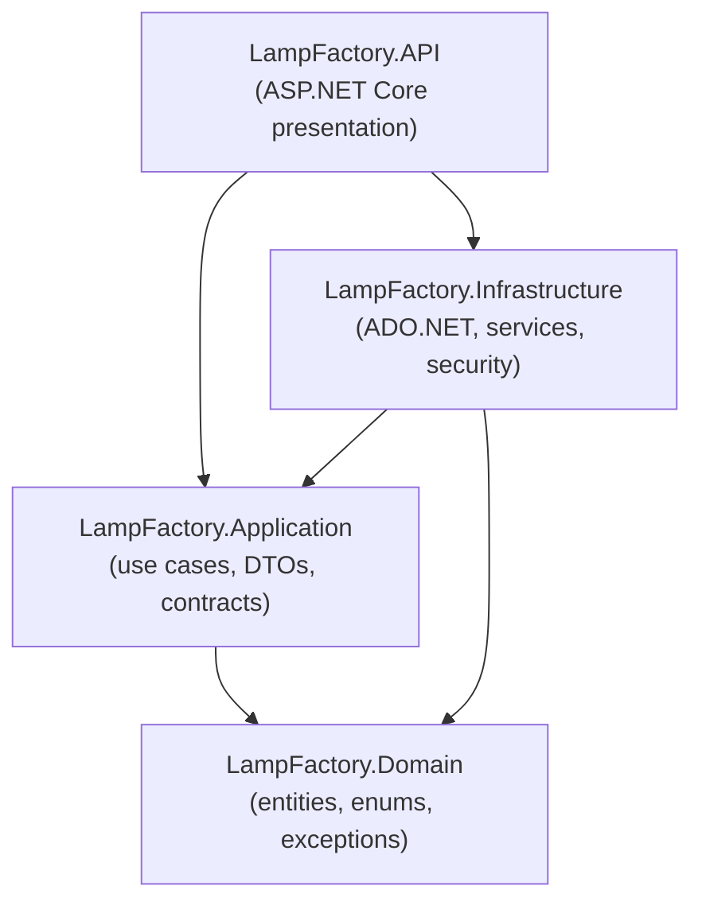

# Architecture

This document describes the architecture **as implemented today** in this repository.
Every claim below is traceable to the source files named in each section.

## Solution layout

The solution file is `Lamp Factory.slnx` (note the space in the file name). It contains
eight projects: four production projects under `src/` and four test projects under `tests/`.

```
Lamp Factory.slnx
├── database/                          SQL Server setup script (lamp-factory.sql)
├── frontend/                          React (Vite) client  → see docs/frontend.md
├── src/
│   ├── LampFactory.API/               Presentation layer
│   ├── LampFactory.Application/       Use cases, DTOs, validators, contracts
│   ├── LampFactory.Domain/            Entities, enums, domain exceptions
│   └── LampFactory.Infrastructure/    ADO.NET persistence, concrete services, security
└── tests/
    ├── LampFactory.Domain.Tests/
    ├── LampFactory.Application.Tests/
    ├── LampFactory.Infrastructure.IntegrationTests/
    └── LampFactory.API.FunctionalTests/
```

## Compile-time dependency graph

Project references verified from the `.csproj` files:



- **`LampFactory.Domain`** references no other project. It contains the entities
  grouped by bounded context (`IdentityAccess`, `Inventory`, `Operators`, `Production`,
  `Purchasing`, `QualityControl`, `Sales`, `Vouchers`), the shared `AuditableEntity`
  base (`CreatedAt`, `CreatedBy`, `ModifiedAt`, `ModifiedBy`), three enums
  (`ProductType`, `WarehouseType`, `QualityControlType`), and the domain exception
  `InsufficientStockException`.
- **`LampFactory.Application`** references only `Domain`. It owns the service
  contracts (`IProductService`, …), the request/response DTOs, the FluentValidation
  validators, the `Result` / `Result<T>` result model, and all persistence
  contracts under `Abstractions/Persistence` (`IRepository<T>` plus one interface
  per aggregate, and two read-side report query contracts).
- **`LampFactory.Infrastructure`** references `Application` and `Domain`. It
  implements the persistence contracts with raw ADO.NET
  (`Microsoft.Data.SqlClient`), hosts the concrete service implementations, and
  provides the security adapters (`JwtTokenService`, `CurrentUserService`).
- **`LampFactory.API`** references `Application` and `Infrastructure`. It is the
  only project that knows about ASP.NET Core: controllers, the permission
  authorization filter, the exception-handling middleware, and the OpenAPI/Scalar
  wiring.

## Where each kind of code lives

| Concern | Contracts / abstractions | Implementations |
|---|---|---|
| Feature services | `src/LampFactory.Application/Features/**` (e.g. `IProductService`) | `src/LampFactory.Infrastructure/Services/**` (22 services, namespaces `LampFactory.Infrastructure.Services.*`) |
| Repository contracts | `src/LampFactory.Application/Abstractions/Persistence/**` (mirrors the feature sub-path; `IRepository<T>` at the root) | `src/LampFactory.Infrastructure/Persistence/Repositories/**` (20 repositories) |
| Report queries (read side) | `Abstractions/Persistence/Reports/` (`IProductionTraceabilityReportQuery`, `IMaterialConsumptionVarianceReportQuery`) | `src/LampFactory.Infrastructure/Reports/` |
| Security | `Application/Abstractions/Security/` (`ICurrentUserService`, `ITokenService`) | `Infrastructure/Security/` (`CurrentUserService`, `JwtTokenService`) |
| DTOs + validators | `Application/Features/**` (`*DTO.cs`, `*Validator.cs` — 20 validators) | — (validators are pure rules; no separate impl) |
| DB connection factory | — | `Infrastructure/Persistence/ApplicationDbContext.cs` |

## Composition root and dependency injection

`src/LampFactory.API/Program.cs` is the only composition root. The API is the
one project that must reference **both** Application and Infrastructure at
compile time — but only so it can *register* the Infrastructure
implementations behind the Application contracts at startup. Runtime
dependency flow still follows the inward rule: every consuming type sees
contracts from Application (`IProductService`, `IUserRepository`, …); concrete
implementations are resolved exclusively through the container below. Nothing
in Domain or Application references Infrastructure.

It calls, in order:

1. `AddControllers()` — MVC controllers.
2. `AddInfrastructureServices()` — the **single DI front door**, defined in
   `src/LampFactory.Infrastructure/DependencyInjection.cs`. It registers:
   - every FluentValidation validator found in the Application assembly
     (`AddValidatorsFromAssembly`),
   - `ApplicationDbContext` (scoped),
   - `IHttpContextAccessor` + `ICurrentUserService` → `CurrentUserService` (scoped),
   - `ITokenService` → `JwtTokenService` (scoped),
   - 20 repository interfaces → their ADO.NET implementations (scoped),
   - 2 report query contracts → their implementations (scoped),
   - 22 feature service interfaces → their concrete implementations (scoped).
3. `AddJwtAuthentication(configuration)` — JWT Bearer validation
   (`Extensions/WebApplicationExtensions.cs`).
4. `AddCustomCors()` — the `AllowReactDev` policy.
5. `AddCustomOpenApi()` — OpenAPI document with a Bearer security scheme.

At application build time, `UseApiMiddleware()` inserts
`ExceptionHandlingMiddleware` as the first middleware, followed by
`UseCors("AllowReactDev")`, `UseHttpsRedirection()`, `UseAuthentication()`,
`UseAuthorization()`, and `MapControllers()`. OpenAPI (`MapOpenApi`) and the
Scalar UI (`MapScalarApiReference`) are mapped **only when
`app.Environment.IsDevelopment()`**.

## Runtime request flow

Each stage below is verified in source; the `alt`/`else` branches show the
short-circuits — a rejected request never reaches a controller, and a
validation failure never reaches a repository.

```mermaid
sequenceDiagram
    participant C as Client (React)
    participant M as ExceptionHandlingMiddleware
    participant A as Authentication middleware<br/>(JWT Bearer)
    participant F as PermissionAuthorizationFilter<br/>(IAsyncAuthorizationFilter)
    participant P as IPermissionService<br/>+ repository
    participant Ctrl as Controller
    participant Svc as Feature service<br/>(Infrastructure impl)
    participant V as FluentValidation validator
    participant R as Aggregate repository (ADO.NET)
    participant DB as SQL Server

    C->>M: HTTP request (Bearer token)
    M->>A: downstream
    A->>A: validate JWT (issuer, audience, lifetime, signing key)
    A->>F: proceed with principal (anonymous if no/invalid token)
    F->>F: resolve user id from NameIdentifier claim
    alt no resolvable user id (anonymous or invalid token)
        F-->>C: 401 UnauthorizedResult — controller never runs
    else user id resolved
        F->>P: HasUserPermissionAsync(userId, resource, action)
        P->>DB: single parameterized join:<br/>UserRoles ⋈ RolePermissions ⋈ Permission ⋈ Resource ⋈ Action
        alt grant missing
            F-->>C: 403 ForbidResult — controller never runs
        else grant present
            F->>Ctrl: invoke action
            Ctrl->>Svc: feature call (e.g. CreateAsync)
            Svc->>V: validate request DTO
            alt validation fails
                Svc-->>Ctrl: Result with ErrorType.Validation<br/>(repo untouched)
                Ctrl-->>C: 400 error envelope
            else validation passes
                Svc->>R: parameterized SQL<br/>(explicit transaction for header-detail writes)
                R->>DB: INSERT / UPDATE / DELETE + audit stamps<br/>from ICurrentUserService
                R-->>Svc: entity / rows
                Svc-->>Ctrl: Result&lt;T&gt; success
                Ctrl-->>C: 200 or 201 envelope (204 = no body)<br/>[cross-checked by ResultMappingTests]
            end
        end
    end
```

Setting `context.Result` inside an `IAsyncAuthorizationFilter` short-circuits
MVC, which the filter (`src/LampFactory.API/Authorization/` +
`PermissionAuthorizationFilter.cs`) uses for both rejection paths: 401 via
`UnauthorizedResult` when no user id is resolvable, then `ForbidResult` when
`HasUserPermissionAsync` returns false. Only a granted request continues into
a controller action.

Two facts about this flow are worth stating explicitly:

- **Authorization is a two-stage design.** Class-level `[Authorize]` makes JWT
  validation a hard requirement, then the `[HasPermission(resource, action)]`
  attribute (`API/Authorization/`) resolves the current user id from the JWT
  `NameIdentifier` claim and asks `IPermissionService` — backed by a single
  parameterized join query — whether the grant exists. There is no role check
  in the filter; roles matter only through `RolePermissions` rows.
- **Audit stamps are server-side.** Repositories write `CreatedBy`/`ModifiedBy`
  from `ICurrentUserService.ActorId`, never from client input. When no
  authenticated principal exists (login/refresh are the only such writers), the
  stamp falls back to the seeded system user id `1` and the fallback is logged
  (`CurrentUserService.IsSystemActor`).

## Result model and HTTP mapping

`Application/Common/Results/` defines `IResult`, `Result` (non-generic) and
`Result<T>`, each carrying `IsSuccess` plus an optional `AppError`
(`ErrorType` ∈ Validation, NotFound, Conflict, Unauthorized, Forbidden).
Services never throw for expected failures; they return failed results.

`API/Common/ResultMappingExtensions.cs` is the single place where results become
HTTP responses. The envelope contract is
`{ isSuccess, statusCode, errorMessage, result }`, serialized by the default
`System.Text.Json` camelCase policy (no custom `JsonOptions` are configured in
the API project).

| Outcome | HTTP status | Body |
|---|---|---|
| `Result<T>.Success` via `ToActionResult` | 200 | success envelope with `result` payload |
| Success via `ToCreatedAtActionResult` with route values | 201 + `Location` header | success envelope |
| Success via `ToCreatedAtActionResult` without route values | 201 (no `Location`) | success envelope |
| Non-generic success via `ToActionResult` | 200 | envelope without payload |
| Delete success via `ToNoContentActionResult` | 204 | **no body** |
| `ErrorType.Validation` | 400 | error envelope, `errorMessage` = validation errors |
| `ErrorType.NotFound` | 404 | error envelope |
| `ErrorType.Conflict` | 409 | error envelope |
| `ErrorType.Unauthorized` | 401 | error envelope |
| `ErrorType.Forbidden` | 403 | error envelope |

## Exception handling

`API/Middleware/ExceptionHandlingMiddleware.cs` is registered first so it sees
every downstream exception, including model-binding and authorization failures.
It maps:

- `NotFoundException` (defined in `Application/Common/Exceptions/`) → 404 with
  the exception message,
- `ConflictException` → 409 with the exception message,
- `UnauthorizedAccessException` → 401 with the exception message,
- anything else → **500 with the fixed message "An unexpected error occurred."**
  (internal details are logged, never returned).

Log emission uses source-generated `[LoggerMessage]` delegates.

Note: `InsufficientStockException` (a Domain exception) is **not** in the
middleware's special-case list, so an insufficient-stock failure currently
surfaces as the generic 500 response. This is documented as a known limitation
in [security.md](security.md#known-limitations) and the repository report.

## Transactions and header-detail operations

Every aggregate that owns a detail collection (vouchers with product lines,
BOMs with components, production plans with products, production documents with
operator assignments, users with roles, warehouses with stock rows) is written
by a dedicated repository method — `CreateWithProductsAsync`,
`UpdateWithOperatorsAsync`, `RemoveWithProductsAsync`, … — that:

1. opens one `SqlConnection` from `ApplicationDbContext.CreateConnection()`,
2. begins an explicit transaction,
3. inserts/updates the header row (`SELECT SCOPE_IDENTITY()` for new ids),
4. deletes-and-reinserts or inserts the detail rows,
5. applies the inventory side effects (see [database.md](database.md#inventory-persistence)),
6. commits — or rolls back on **any** exception (including
   `InsufficientStockException`) and rethrows.

`Update*` implementations restore the previous detail state first (for example,
a sales-voucher update re-increases the old warehouse quantities before
re-validating and re-deducting the new lines), so the stock effect of an update
is the *net* difference, computed entirely inside the transaction.

## Honest positioning

The solution follows the Clean Architecture *dependency rule* strictly —
`Application` depends only on `Domain`, and persistence contracts live in
Application while their implementations live in Infrastructure. It is not,
however, a textbook Clean Architecture layout in one respect: the concrete
**service implementations live in Infrastructure** (next to the repositories
they orchestrate), not in Application. Application remains the home of
contracts, DTOs, validators and the result model; Infrastructure is the
implementation assembly for both services and data access. This documentation
deliberately describes that actual arrangement instead of presenting the
classic layering.
