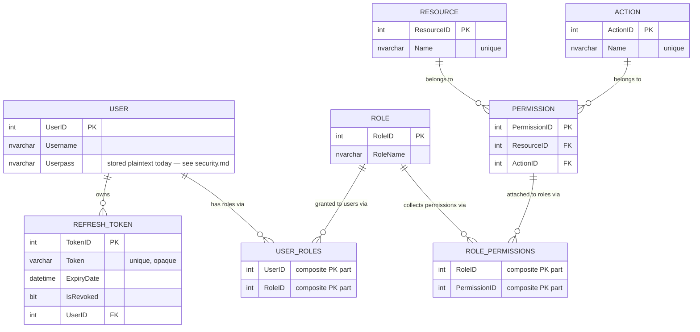
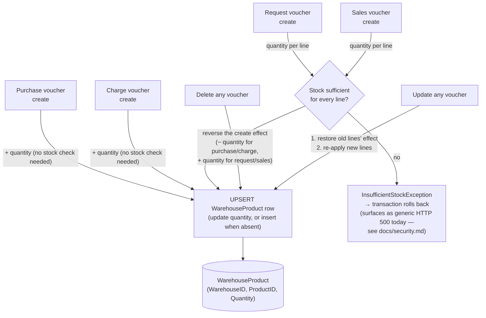

# Database

This document describes the actual database layer: how the schema is created,
how the application talks to SQL Server, and how writes stay consistent.
Every claim is traceable to the named source files.

## Supported setup

- **Engine:** Microsoft SQL Server. The default connection string targets a
  local instance with Windows authentication:
  `Server=localhost;Database=lampdb;Trusted_Connection=True;TrustServerCertificate=True;Connect Timeout=30;`
  (`src/LampFactory.API/appsettings.json`, key `ConnectionStrings:DefaultConnection`).
- **Driver:** `Microsoft.Data.SqlClient` **7.0.2** (version from the csproj).
  There is **no ORM and no EF Core migrations** — the schema is managed by a
  plain SQL script and all data access is hand-written ADO.NET.
- **Access point:** `Infrastructure/Persistence/ApplicationDbContext.cs` is a
  small connection factory. It reads the connection string once and exposes
  `CreateConnection()`. Repositories open, use, and dispose their own
  connections; no connection pooling is configured beyond the driver default.

## Creating the database

The reviewed schema script is `database/lamp-factory.sql`. It:

- creates the `lampdb` database if it does not exist (`IF NOT EXISTS … CREATE DATABASE`),
- switches context with `USE lampdb` / `GO`,
- creates **29 tables** in dependency order (referenced tables first):
  `User`, `Role`, `Resource`, `Action`, `Permission`, `UserRoles`,
  `RolePermissions`, `Product`, `BOM`, `BOMComponent`, `Warehouse`,
  `WarehouseProduct`, `ProductionPlan`, `ProductionPlanProduct`,
  `ProductionLine`, `ProductionDocument`, `Operator`,
  `ProductionDocumentOperator`, `LineStop`, `QualityControl`,
  `SalesVoucher`, `SalesVoucherProduct`, `PurchaseVoucher`,
  `PurchaseVoucherProduct`, `RequestVoucher`, `RequestVoucherProduct`,
  `ChargeVoucher`, `ChargeVoucherProduct`, `RefreshToken`.
- contains **no INSERT statements** — it creates structure only.

Run it with a tool that understands `GO` batches:

```bash
sqlcmd -S localhost -E -i database/lamp-factory.sql
```

(or open it in SQL Server Management Studio and execute). The script contains
no credentials, no developer-specific paths, and no destructive operations
against existing databases other than creating `lampdb` when absent.

### Setup gaps (verified)

- **No seed data.** The script inserts nothing. The application expects a user
  with `UserID = 1` to exist (the audit-stamp fallback target,
  `CurrentUserService.SystemUserId`), and the first administrative user can
  only be created through the authenticated `POST /api/User` endpoint — which
  itself requires an existing login and permission grants. **Bootstrapping a
  fresh database therefore currently requires a manual `INSERT` for the first
  user, their role, and the role-permission rows; that seed script is not in
  the repository.** This is documented as a setup gap, not silently papered over.
- The audit-stamp fallback means writes performed before an authenticated user
  exists are attributed to `UserID = 1`; rows violating that foreign key would
  fail, which is why the fallback exists.

## Entity groups and relationships

The schema mirrors the Domain entities (`src/LampFactory.Domain/**`). The two
diagrams below are derived **directly from the `FOREIGN KEY` constraints in
`database/lamp-factory.sql`** — the complete FK set was extracted from the
script; no relationship below comes from naming conventions alone. Every table
(including `User` itself) also carries `CreatedBy`/`ModifiedBy` foreign keys
to `User.UserID` for the audit stamps; those edges are omitted from the
diagrams for readability.

### Identity & access (FK-derived)



### Manufacturing, inventory & voucher domain (FK-derived)

```mermaid
erDiagram
    PRODUCT {
        int ProductID PK
        nvarchar ProductType "Final / Component"
        nvarchar StandardNumber
    }
    WAREHOUSE {
        int WarehouseID PK
        nvarchar WarehouseType "EntryStorage / FinalWarehouse"
    }
    WAREHOUSE_PRODUCT {
        int WarehouseID "composite PK part"
        int ProductID "composite PK part"
        int Quantity "stock on hand; nullable"
    }
    BOM {
        int BOM_ID PK
        int ProductID FK
    }
    BOM_COMPONENT {
        int ProductID "composite PK part"
        int BOM_ID "composite PK part"
        float ConsumptionAmount
    }
    PRODUCTION_PLAN {
        int ProductionPlanID PK
        date IssueDate
        date TargetDate
    }
    PRODUCTION_PLAN_PRODUCT {
        int ProductionPlanID "composite PK part"
        int ProductID "composite PK part"
        int MinQuantity
        int MaxQuantity
    }
    PRODUCTION_LINE {
        int ProductionLineID PK
        bit Status
    }
    PRODUCTION_DOCUMENT {
        int ProductionDocumentID PK
        int ProductionPlanID FK
        int ProductID FK
        int ProductionLineID FK
        int ProducedQuantity
        int RejectedQuantity
    }
    OPERATOR {
        int OperatorID PK
        nvarchar NationalID "unique"
    }
    PRODUCTION_DOCUMENT_OPERATOR {
        int ProductionDocumentID "composite PK part"
        int OperatorID "composite PK part"
        nvarchar OperatorRole
    }
    LINE_STOP {
        int LineStopID PK
        int ProductionDocumentID FK
    }
    QUALITY_CONTROL {
        int QualityControlID PK
        int ProductionDocumentID FK
        nvarchar BatchNumber "unique"
        bit QualityControlAcceptance
    }
    SALES_VOUCHER {
        int SalesVoucherID PK
        int WarehouseID FK
    }
    SALES_VOUCHER_PRODUCT {
        int SalesVoucherID "composite PK part"
        int ProductID "composite PK part"
        int SalesQuantity
    }
    PURCHASE_VOUCHER {
        int PurchaseVoucherID PK
        int WarehouseID FK
        date PurchaseDate
    }
    PURCHASE_VOUCHER_PRODUCT {
        int PurchaseVoucherID "composite PK part"
        int ProductID "composite PK part"
        int PurchasedQuantity
    }
    REQUEST_VOUCHER {
        int RequestVoucherID PK
        int WarehouseID FK
        int ProductionDocumentID FK
        date RequestDate
    }
    REQUEST_VOUCHER_PRODUCT {
        int RequestVoucherID "composite PK part"
        int ProductID "composite PK part"
        int RequestedQuantity
    }
    CHARGE_VOUCHER {
        int ChargeVoucherID PK
        int WarehouseID FK
        int ProductionDocumentID FK
        date ChargeDate
    }
    CHARGE_VOUCHER_PRODUCT {
        int ChargeVoucherID "composite PK part"
        int ProductID "composite PK part"
        int ChargeQuantity
    }
    PRODUCT ||--o{ WAREHOUSE_PRODUCT : "stocked at"
    WAREHOUSE ||--o{ WAREHOUSE_PRODUCT : "holds"
    PRODUCT ||--o{ BOM : "manufacturing recipe for"
    BOM ||--o{ BOM_COMPONENT : "consumes"
    PRODUCT ||--o{ BOM_COMPONENT : "as component"
    PRODUCTION_PLAN ||--o{ PRODUCTION_PLAN_PRODUCT : "targets"
    PRODUCT ||--o{ PRODUCTION_PLAN_PRODUCT : "planned as"
    PRODUCTION_PLAN ||--o{ PRODUCTION_DOCUMENT : "realized by"
    PRODUCT ||--o{ PRODUCTION_DOCUMENT : "produced"
    PRODUCTION_LINE ||--o{ PRODUCTION_DOCUMENT : "produced on"
    PRODUCTION_DOCUMENT ||--o{ PRODUCTION_DOCUMENT_OPERATOR : "staffed by"
    OPERATOR ||--o{ PRODUCTION_DOCUMENT_OPERATOR : "assigned via"
    PRODUCTION_DOCUMENT ||--o{ LINE_STOP : "interspersed with"
    PRODUCTION_DOCUMENT ||--o{ QUALITY_CONTROL : "inspected by"
    WAREHOUSE ||--o{ SALES_VOUCHER : "ships from"
    SALES_VOUCHER ||--o{ SALES_VOUCHER_PRODUCT : "lines"
    PRODUCT ||--o{ SALES_VOUCHER_PRODUCT : "sold as"
    WAREHOUSE ||--o{ PURCHASE_VOUCHER : "received into"
    PURCHASE_VOUCHER ||--o{ PURCHASE_VOUCHER_PRODUCT : "lines"
    PRODUCT ||--o{ PURCHASE_VOUCHER_PRODUCT : "purchased as"
    WAREHOUSE ||--o{ REQUEST_VOUCHER : "draws from"
    PRODUCTION_DOCUMENT ||--o{ REQUEST_VOUCHER : "materials for"
    REQUEST_VOUCHER ||--o{ REQUEST_VOUCHER_PRODUCT : "lines"
    PRODUCT ||--o{ REQUEST_VOUCHER_PRODUCT : "requested as"
    WAREHOUSE ||--o{ CHARGE_VOUCHER : "charged into"
    PRODUCTION_DOCUMENT ||--o{ CHARGE_VOUCHER : "output of"
    CHARGE_VOUCHER ||--o{ CHARGE_VOUCHER_PRODUCT : "lines"
    PRODUCT ||--o{ CHARGE_VOUCHER_PRODUCT : "charged as"
```



Facts the FKs impose (verified in the script): the `WarehouseID` column on
every voucher header is `NOT NULL`, as is the `ProductionDocumentID` column
on `LineStop`, `QualityControl`, `RequestVoucher` and `ChargeVoucher` (the
tables that link a record to a production document). In contrast,
`WarehouseProduct.Quantity` is nullable — `COALESCE(Quantity, 0)` is used
when validating stock. Join tables use composite primary keys; the identity
joins (`UserRoles`, `RolePermissions`) additionally cascade on delete, and
`RefreshToken` cascades on user deletion.

| Group | Tables | Key relationships |
|---|---|---|
| Identity & access | `User`, `Role`, `Resource`, `Action`, `Permission`, `UserRoles`, `RolePermissions`, `RefreshToken` | `UserRoles` and `RolePermissions` are join tables; a `Permission` links one `Resource` to one `Action`; `RefreshToken` belongs to a `User` |
| Inventory | `Product`, `Warehouse`, `WarehouseProduct` | `WarehouseProduct` is the stock ledger row per (warehouse, product) with a nullable `Quantity` |
| Production | `BOM`, `BOMComponent`, `ProductionPlan`, `ProductionPlanProduct`, `ProductionLine`, `ProductionDocument`, `ProductionDocumentOperator`, `LineStop` | `BOMComponent` links a BOM to component products with consumption amounts; a `ProductionDocument` belongs to a plan, a product and a line, and carries operator assignments; `LineStop` references a document |
| Purchasing | `PurchaseVoucher`, `PurchaseVoucherProduct`, `RequestVoucher`, `RequestVoucherProduct` | voucher headers with product-line children; request vouchers also reference a production document |
| Sales | `SalesVoucher`, `SalesVoucherProduct` | voucher header + product lines |
| Vouchers (charging) | `ChargeVoucher`, `ChargeVoucherProduct` | charging produced goods into a warehouse; references a production document |
| Quality control | `QualityControl` | references a production document |

Every business table carries the audit columns `CreatedAt`, `CreatedBy`,
`ModifiedAt`, `ModifiedBy` (mirrored by `Domain/Common/AuditableEntity.cs`).

## The repository pattern as implemented

- Contracts: `Application/Abstractions/Persistence/**` — a minimal generic
  `IRepository<T>` (`GetAllAsync`, `GetByIdAsync`, `CreateAsync`, `UpdateAsync`,
  `RemoveAsync`) plus one richer interface per aggregate (for example
  `ISalesVoucherRepository` adds `CreateWithProductsAsync`,
  `GetByIdWithProductsAsync`, `UpdateWithProductsAsync`,
  `RemoveWithProductsAsync`).
- Implementations: `Infrastructure/Persistence/Repositories/**` — 20 classes,
  all hand-written ADO.NET. Every SQL statement is **parameterized**
  (`SqlCommand.Parameters.AddWithValue`); no string interpolation of user input
  into SQL was found in the repositories or report queries.
- New ids are read back with `SELECT SCOPE_IDENTITY()` so callers persist
  server-generated identities instead of echoing client input.
- Read-side reports live in `Infrastructure/Reports/` (one class per report
  contract) and use the same parameterized style with optional
  `@StartDate` / `@StandardNumber` filters appended as parameterized clauses.

## Header-detail writes and transactions

All multi-row writes are wrapped in an explicit transaction. The pattern
(visible in, for example, `SalesVoucherRepository.CreateWithProductsAsync`):

1. `conn.BeginTransaction()`
2. insert the header row, capture the new id via `SCOPE_IDENTITY()`
3. insert/update/delete the detail rows (product lines, operators, components)
4. apply inventory side effects (below)
5. `CommitAsync()` — or `RollbackAsync()` on any exception and rethrow.

`InsufficientStockException` gets an explicit `catch` that rolls back before
rethrowing. The same rollback-on-any-failure shape exists in the voucher, BOM,
production-plan, production-document, user and warehouse repositories
(`BeginTransaction`/`Commit`/`Rollback` appear across 10 repository classes).

Update flows restore prior state first — e.g. a sales-voucher update
re-increases the old warehouse quantities, replaces the product lines, then
re-validates and re-deducts the new ones — so the net stock effect of an
update is computed inside a single transaction.

## Inventory persistence

Stock lives in `WarehouseProduct (WarehouseID, ProductID, Quantity)`. The four
voucher repositories own the stock effects, always inside the voucher's
transaction:

| Operation | Stock effect (verified SQL paths) |
|---|---|
| Purchase voucher create | **increase** at the voucher's warehouse |
| Charge voucher create | **increase** at the voucher's warehouse (produced goods entering stock) |
| Request voucher create | **validate then decrease** at the source warehouse |
| Sales voucher create | **validate then decrease** at the voucher's warehouse |
| Delete of any voucher | reverses the create effect (decrease for purchase/charge, increase for request/sales) |
| Update of any voucher | reverses the old effect, then re-applies the new lines |

### Stock movement flow

Every arrow below happens inside the voucher's own SQL transaction; the
diagram condenses the verified effects table above.



Two details worth calling out: purchase and charge vouchers need no stock
validation because they only ever add units, while request and sales vouchers
decrease stock and are therefore gated by the validation step. The update
path restores the previous lines' quantities first, so the *net* effect of an
update is computed within the single transaction.

Validation compares `COALESCE(Quantity, 0)` against the requested amount and
throws the domain exception `InsufficientStockException`
(`Domain/Inventory/`) when stock is short; the transaction rolls back. The
increase/decrease helpers are upserts: they `UPDATE` the existing
warehouse-product row or `INSERT` one when absent (a decrease may create a
negative-quantity row only if no row existed — the validation path prevents
that for request/sales vouchers).

## Known limitations

- **No migrations.** Schema changes are manual edits to the SQL script; there
  is no versioned migration history.
- **No seed data** (see the setup gap above) — a fresh database cannot be
  bootstrapped through the API alone.
- `AddWithValue` is used throughout. It infers parameter types from the value;
  it is parameterized (not injectable) but does not declare explicit SQL types.
- No optimistic concurrency (no rowversion columns) and no unique constraints
  beyond the ones in the schema script; concurrent stock updates rely on the
  transaction's default isolation level.
- The reports and audit log read directly from the same database with no
  read replica or caching layer.
