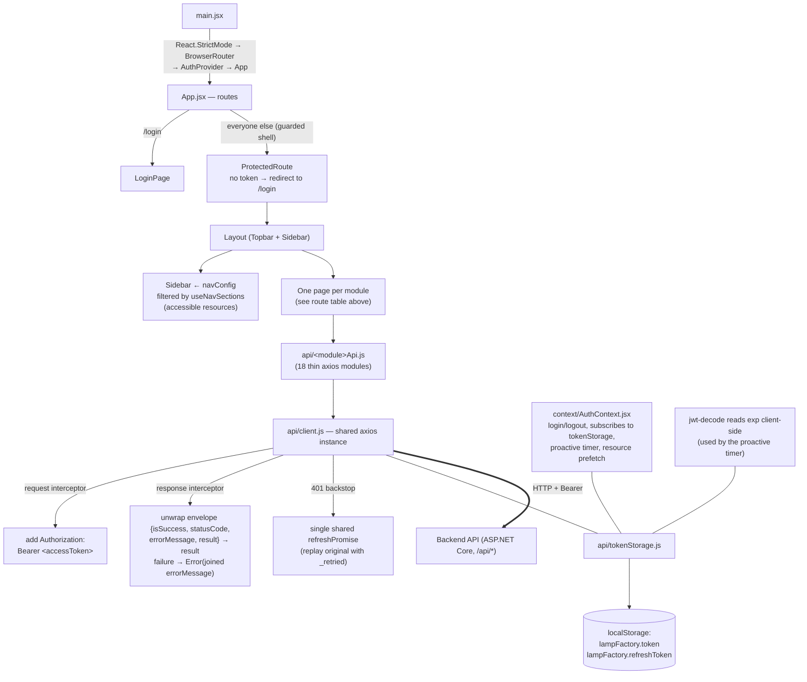
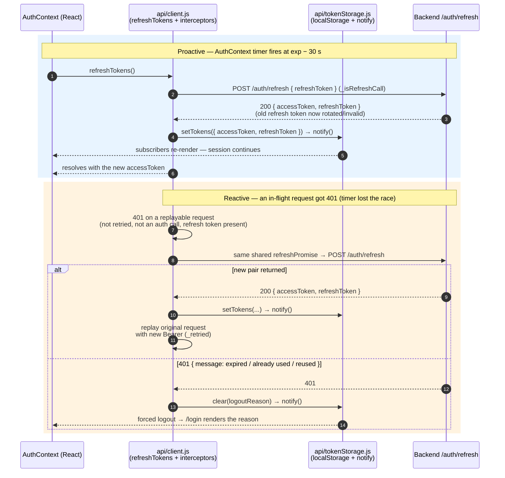

# Frontend

Documents the React client as it exists in `frontend/`. Stack versions come
from `frontend/package.json`; behavior claims cite the actual source files.

## Stack

| Library | Version (package.json) |
|---|---|
| React / React DOM | ^18.3.1 |
| react-router-dom | ^6.26.2 |
| axios | ^1.7.7 |
| jwt-decode | ^4.0.0 |
| lucide-react | ^0.383.0 |
| Vite | ^5.4.8 (build tool, `@vitejs/plugin-react` ^4.3.1) |
| Tailwind CSS | ^3.4.13 (+ PostCSS ^8.4.47, autoprefixer ^10.4.20) |

**Node.js is not pinned by the project** — `package.json` declares no
`engines` field and no `.nvmrc` exists. The build was observed succeeding on
Node **v23.0.0**; that is an observation, not a requirement.

## Folder structure (source only)

```
frontend/
├── .env.example               # VITE_API_BASE_URL template
├── index.html                 # Vite entry (loads /src/main.jsx)
├── package.json / package-lock.json
├── vite.config.js             # plugin-react, port 5173
├── tailwind.config.js / postcss.config.js
└── src/
    ├── main.jsx               # bootstrap
    ├── App.jsx                # providers + router
    ├── api/                   # one axios module per backend module + shared client
    │   ├── client.js          # axios instance, interceptors, envelope unwrap
    │   ├── tokenStorage.js    # localStorage tokens, subscriptions, expiry helpers
    │   └── <module>Api.js     # audit, boms, chargeVouchers, lineStops, operators,
    │                          # productionDocuments, productionLines, productionPlans,
    │                          # products, purchaseVouchers, qualityControl, rbac,
    │                          # reports, requestVouchers, roles, salesVouchers,
    │                          # users, warehouses
    ├── components/            # Layout, Sidebar, Topbar, ProtectedRoute, navConfig,
    │   │                      # pickers (Product/Warehouse/Plan/Document/ProductionLine/
    │   │                      # Operator), editors (LineItems*, BOMComponents,
    │   │                      # OperatorAssignments, ProductionPlanProducts),
    │   │                      # AuditStamp, filters, and ui/ primitives
    │   └── ui/                # Button, Modal, Field, ConfirmDialog, ErrorBanner,
    │                          # Pagination, SortableTh
    ├── context/AuthContext.jsx# session state, login/logout, resource prefetch
    ├── hooks/ & lib/          # usePagedList, useSortable, useNavSections +
    │                          # useProducts/useWarehouses/useRoles/… shared loaders
    └── pages/                 # one folder per backend module (below)
```

## Client architecture (verified wiring)



The wires above are the actual imports: `main.jsx` nests
`BrowserRouter → AuthProvider → App`; pages never talk to axios directly —
they go through the per-module wrappers in `src/api/`; `AuthContext` does not
own the token state, it subscribes to `tokenStorage` so that interceptor-driven
renewals and forced logouts re-render the React tree.

## Authentication and token handling

The flow implemented in `src/context/AuthContext.jsx`, `src/api/tokenStorage.js`
and `src/api/client.js`:

1. **Login** posts `{ Username, Password }` to `/auth/login` (request binding
   on the backend is case-insensitive). On success the response carries
   `accessToken` + `refreshToken` (camelCase on the wire), both persisted to
   `localStorage` under **`lampFactory.token`** and
   **`lampFactory.refreshToken`**.
2. **Every request** attaches `Authorization: Bearer <accessToken>` via an
   axios request interceptor.
3. **Proactive renewal:** `AuthContext` schedules it — the JWT's `exp` is read
   client-side (`jwt-decode`), and a `setTimeout` fires at `exp − 30 s`
   (`REFRESH_LEEWAY_SECONDS = 30`), ahead of the 5-minute server lifetime,
   calling the shared `refreshTokens()`.
4. **Reactive renewal (backstop):** a `401` triggers **one** silent
   `POST /auth/refresh` and replays the original request. Concurrent refreshes
   are collapsed into a single shared promise (`refreshPromise`) — deliberate,
   because the backend rotates refresh tokens and treats a reuse as theft
   (which would revoke all sessions).
5. **Forced logout:** when a refresh is rejected (expired, already rotated,
   reused), tokens are cleared and the backend's explanation is surfaced on
   the login screen (`logoutReason`); the session cannot survive it.
6. `AuthContext` subscribes to `tokenStorage` rather than owning the state, so
   silent renewals and forced logouts performed by the interceptor keep React
   in sync. Login also prefetches the user's accessible resources
   (`GET /api/Resource/my-accessible`) to drive the navigation.
7. `ProtectedRoute` guards the app shell; unauthenticated users land on
   `/login`.

### Token renewal and rotation as implemented

Proactive renewal is scheduled by **`AuthContext`** (a `setTimeout` firing at
`exp − 30 s`, calling the shared `refreshTokens()`); the reactive backstop is
the **axios response interceptor in `client.js`** (one shared `refreshPromise`,
original request replayed with `_retried`). Both paths converge on the same
rotation endpoint:

Both paths converge on the **same exported `refreshTokens()`** in
`client.js` — one shared promise — and it is `refreshTokens()` that writes the
new pair into `tokenStorage` (line 34: `tokenStorage.setTokens(...)`), so the
React tree stays in sync through the `tokenStorage` subscription either way:



Two safeguards shown above come from code: the `_isRefreshCall` flag marks the
refresh request itself so its own 401 can never schedule another refresh, and
collapse of concurrent 401s into one shared promise prevents two rotations from
racing — which matters because the backend treats reuse of an already-rotated
refresh token as theft and revokes every session for that user.

## Connecting to the API

`src/api/client.js`:

- Base URL: `import.meta.env.VITE_API_BASE_URL`, falling back to
  `https://localhost:7263/api` — the API's HTTPS development port.
- **Envelope unwrapping:** every controller response is the backend envelope
  `{ isSuccess, statusCode, errorMessage, result }` (camelCase, verified in
  `client.js`'s own contract comment and against live responses). Successful
  calls are unwrapped so callers receive `result` directly; failures throw an
  `Error` carrying the joined `errorMessage` list.
- Errors that bypass the envelope are normalized too: the auth endpoints'
  `{ message }` bodies and ASP.NET validation `title`/`errors` bodies are
  mapped into readable messages.
- The refresh call itself is flagged (`_isRefreshCall`) so a 401 from it can
  never trigger another refresh (loop protection).

`VITE_API_BASE_URL` is the only environment variable the frontend supports;
`frontend/.env.example` documents it. It must include the `/api` suffix.

## Routes (from `src/App.jsx`)

| Path | Page |
|---|---|
| `/login` | `LoginPage` |
| `/` | `DashboardPage` (index of the guarded shell) |
| `/products` | `ProductsPage` |
| `/warehouses` | `WarehousesPage` |
| `/operators` | `OperatorsPage` |
| `/production-lines` | `ProductionLinesPage` |
| `/boms` | `BOMsPage` |
| `/production-plans` | `ProductionPlansPage` |
| `/production-documents` | `ProductionDocumentsPage` |
| `/quality-control` | `QualityControlPage` |
| `/line-stops` | `LineStopsPage` |
| `/purchase-vouchers` | `PurchaseVouchersPage` |
| `/request-vouchers` | `RequestVouchersPage` |
| `/sales-vouchers` | `SalesVouchersPage` |
| `/charge-vouchers` | `ChargeVouchersPage` |
| `/users`, `/roles`, `/resources`, `/actions`, `/permissions` | admin pages (`UsersPage`, `RolesPage`, `ResourcesPage`, `SysActionsPage`, `PermissionsPage`) |
| `/audit-log` | `AuditLogPage` |
| `/reports/traceability` | `ProductionTraceabilityPage` |
| `/reports/material-variance` | `MaterialConsumptionVariancePage` |
| (catch-all from `navConfig`) | `PlaceholderPage` for navigation entries without a screen yet |

The sidebar is generated from `src/components/navConfig.js`, grouped to mirror
the SKD production flow (master data → planning & BOM → production → vouchers
→ reports → admin); `hooks/useNavSections.js` filters it by the user's
accessible resources.

## Commands

```bash
cd frontend
npm ci                      # install exactly per package-lock.json
cp .env.example .env        # PowerShell: Copy-Item .env.example .env — set VITE_API_BASE_URL
npm run dev                 # dev server on http://localhost:5173
npm run build               # production build into dist/ (observed: ✓ built in ~4 s)
npm run preview             # serve the built dist/ locally
```

Development must keep the browser origin at `http://localhost:5173` — that is
the only origin the backend's CORS policy allows (`AllowReactDev`).
