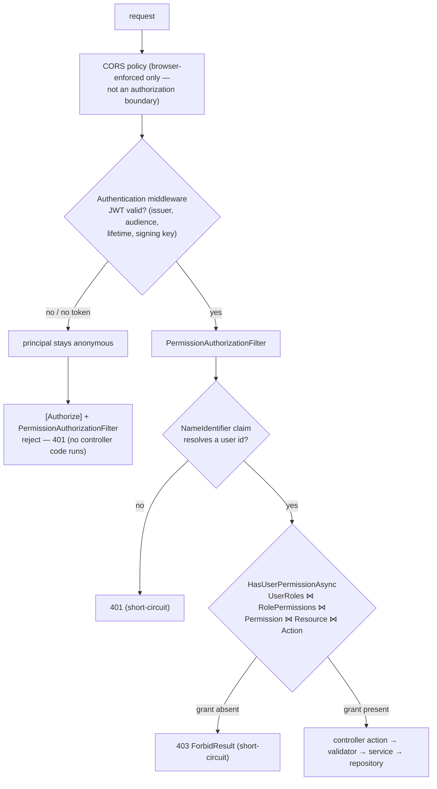

# Security

This document describes the security implementation exactly as it exists in
the source today — including its verified weaknesses. Code was not changed as
part of writing this document; every finding names the file it comes from.

## What is in place

### JWT access tokens

`Infrastructure/Security/JwtTokenService.cs` (implements
`Application/Abstractions/Security/ITokenService`):

- Algorithm: **HMAC-SHA256** with a symmetric key.
- Claims: `ClaimTypes.NameIdentifier` (user id), `ClaimTypes.Name` (username).
  No role claims are issued.
- **Access-token lifetime: 5 minutes** (`DateTime.UtcNow.AddMinutes(5)`).
- Signing material, issuer and audience come from configuration keys
  `Jwt:Key`, `Jwt:Issuer`, `Jwt:Audience`.

Validation (`API/Extensions/WebApplicationExtensions.cs` → `AddJwtAuthentication`)
enables `ValidateIssuer`, `ValidateAudience`, `ValidateLifetime` and
`ValidateIssuerSigningKey`, all bound to the same configuration keys. The
token's `exp` plus the framework's default clock skew govern expiry; no custom
clock skew is configured.

### Refresh tokens

`Infrastructure/Services/IdentityAccess/Authentication/AuthService.cs`:

- Refresh tokens are **opaque random values: 64 bytes from
  `RandomNumberGenerator`, base64-encoded** (`JwtTokenService.GenerateRefreshToken`).
- Stored in the `RefreshToken` table with creation time, a **7-day expiry**,
  a revocation flag and the owning user id.
- **Single-use rotation:** every successful `/api/Auth/refresh` revokes the
  presented token and issues a new pair.
- **Reuse detection:** presenting an already-revoked token is treated as
  token theft — **all sessions for that user are revoked immediately** and the
  client receives `UnauthorizedAccessException`'s message as a 401.

### Authentication pipeline

`Program.cs` middleware order: `ExceptionHandlingMiddleware` → CORS →
`UseHttpsRedirection` → `UseAuthentication` → `UseAuthorization` → controllers.
Every controller except `AuthController` is `[Authorize]`, so an expired or
missing JWT yields **401** before any business code runs (verified by the
functional test `SecuredEndpoint_WhenAnonymous_ReturnsUnauthorized`).

### Permission-based authorization

- `Authorization/HasPermissionAttribute(resource, action)` is a
  `TypeFilterAttribute` for `PermissionAuthorizationFilter`
  (`IAsyncAuthorizationFilter`).
- The filter resolves the user id from the authenticated principal via
  `ICurrentUserService.UserId`; unauthenticated → **401**.
- It then calls `IPermissionService.HasUserPermissionAsync`, implemented by a
  single parameterized join query:
  `UserRoles ⋈ RolePermissions ⋈ Permission ⋈ Resource ⋈ Action`
  (`PermissionRepository.CheckUserPermissionAsync`). A missing grant →
  `ForbidResult` → **403**.
- Roles influence authorization only through those join tables; there are no
  hard-coded role checks.

### Login, access-token use and the rejected-refresh path

The sequence reflects `AuthService.LoginAsync` / `RefreshAsync` (rotation +
reuse revocation) and the client behavior documented in
[frontend.md](frontend.md#token-renewal-and-rotation-as-implemented):

```mermaid
sequenceDiagram
    autonumber
    participant C as Client
    participant AUTH as AuthService<br/>(Infrastructure)
    participant DB as SQL Server
    participant J as JwtTokenService

    rect rgb(232, 244, 255)
    Note over C,J: Login — POST /api/Auth/login (anonymous)
    C->>AUTH: LoginDTO { username, password }
    AUTH->>DB: load users, find match, compare u.Userpass == model.Password (plaintext)
    alt no match
        AUTH-->>C: 401 { "message": "Incorrect username or password." }
    else match
        J->>J: HMAC-SHA256 access token (5 min,<br/>NameIdentifier + Name claims)
        J->>J: opaque refresh token (64 random bytes,<br/>7-day row in RefreshToken)
        AUTH-->>C: 200 { accessToken, refreshToken } — NOT the envelope
        C->>C: store both in localStorage
    end
    end

    rect rgb(240, 255, 240)
    Note over C,J: Access-token use — business endpoints
    C->>C: every request carries Bearer <accessToken>
    Note over C: 401 paths: missing/invalid token → [Authorize]/filter;<br/>5-min expiry → proactive 30-s refresh in the client
    end

    rect rgb(255, 243, 224)
    Note over C,J: Rotation — POST /api/Auth/refresh (anonymous)
    C->>AUTH: RefreshRequestDTO { refreshToken }
    AUTH->>DB: look up token row (expiry, revocation flag)
    alt unknown / expired / already revoked
        AUTH-->>C: 401 { "message": reason }
        Note over AUTH,DB: reuse (already-revoked) is treated as theft:<br/>all sessions of that user are revoked
        C->>C: forced logout, reason shown on /login
    else valid
        AUTH->>DB: revoke presented token (single-use)
        J->>J: issue new access + refresh pair
        AUTH-->>C: 200 { accessToken, refreshToken }
    end
    end
```

### Decision chain: authentication and authorization as separate stages



Note what does not protect anything here: a denied permission and a missing
token fail at the filter, before any business logic; CORS only constrains
browsers, so the real authorization boundary is the filter chain, not the
CORS policy.

### Audit identity

`Infrastructure/Security/CurrentUserService.cs`:

- `UserId` is read from the JWT `NameIdentifier` claim; services never touch
  `HttpContext`.
- Repositories stamp `CreatedBy`/`ModifiedBy` from `ActorId` — server-side
  values, never trusted from the client (comment and usage in
  `AuditableEntity` and the repositories).
- When no principal exists (only login/refresh write rows anonymously), the
  stamp falls back to the seeded system user (`UserID = 1`) and the fallback
  is **logged as a warning**, not applied silently.

### CORS

`AddCustomCors` registers a single policy, `AllowReactDev`, allowing exactly
`http://localhost:5173` with any header/method, no credentials. Any other
origin is rejected by the policy. For anything beyond local development this
list must be revisited.

Two things CORS is — and is not — in this application:

- **It is browser-enforced only.** The `AllowReactDev` policy decides which
  *browsers* may let JavaScript from another origin read responses. It does
  **not** protect the API from unauthorized *clients*: curl, Postman, scripts
  or any non-origin-restricted HTTP agent ignore CORS entirely and hit the
  endpoints directly.
- **It is not a substitute for the server-side authorization above.** The
  protection actually enforced on the wire for non-browser clients comes from
  `[Authorize]` (401) and `[HasPermission]` (403) — independent of CORS. CORS
  plays no role in whether a request without a valid token succeeds.

### Secret and configuration management

- `appsettings.json` in the repository holds **no secret values**: `Jwt:Key`
  is an empty string and the connection string uses Windows authentication
  (no SQL credentials). Verified previously with a secret scanner
  (gitleaks) against the exact git index content: no leaks.
- The API project carries a `UserSecretsId`; local development supplies the
  signing key via `dotnet user-secrets` (instructions in
  [development.md](development.md#2-configure-the-jwt-signing-key)) or
  environment variables for deployment.
- OpenAPI and the Scalar UI are mapped **only in Development** — they do not
  run in production mode.

### Error handling

`ExceptionHandlingMiddleware` returns a generic 500 ("An unexpected error
occurred.") for anything it does not specifically recognize; `NotFoundException`,
`ConflictException` and `UnauthorizedAccessException` messages are returned
because they carry business meaning. Stack traces and internal details are
logged, never returned. Expected domain failures travel as `Result` errors, so
they never include exception details at all.

## Password storage (verified trace)

The complete path was inspected: registration → validation → storage → login.
**Passwords are stored and compared in plaintext.** There is no hashing,
salting, or key-derivation anywhere in the codebase — not because a keyword
search missed it, but because the actual code paths were read end-to-end:

1. **Create/update:** `UserController` → `UserService` →
   `UserRepository.CreateWithRolesAsync` / `UpdateWithRolesAsync` executes
   `INSERT INTO [User] (Username, Userpass, …) VALUES (@Username, @Userpass, …)`
   with `@Userpass` bound to `user.Userpass` — the value received from the
   request DTO (`UserRolesDTO.User.Userpass`), only length-checked
   (`MaximumLength(100)`) by `UserRolesDTOValidator`.
2. **Login:** `AuthService.LoginAsync` loads users and compares
   `u.Userpass == model.Password` — a direct string equality against the
   stored column.
3. **Read side:** the same repository `SELECT`s `Userpass`, and the entity is
   serialized in `GET /api/User` responses (see the note in [api.md](api.md)).

Consequences (reported, not fixed in this documentation task):

- anyone with database read access (a leak, a backup, a support query) obtains
  every user's working password;
- **password values are returned by the user endpoints** to any principal
  holding `SystemUser:Read`;
- there is no password policy beyond a length limit, no lockout, and no
  rate limiting on `/api/Auth/login`.

**Required follow-up (separate code task):** hash passwords with a purpose-built
KDF (e.g. PBKDF2 via `Rfc2898DeriveBytes`, or ASP.NET Core Identity's hasher),
store only the hash, compare with a constant-time verification routine, and
stop serializing `Userpass` in read/create/update responses. Existing plaintext
values would need a migration; until then treat every stored password as
compromised-by-design.

## Known limitations

Security-relevant limitations verified in the current implementation:

1. **Plaintext passwords** (above) — the most serious finding.
2. **Access + refresh tokens live in `localStorage`** on the client
   (`frontend/src/api/tokenStorage.js`, keys `lampFactory.token` /
   `lampFactory.refreshToken`). Any successful XSS in the SPA can read them.
   `HttpOnly` cookies would mitigate this; the current design favors a
   stateless API client.
3. **`InsufficientStockException` surfaces as a generic 500** — the exception
   middleware special-cases only NotFound/Conflict/Unauthorized; a stock
   failure is indistinguishable from a server fault on the wire.
4. **Login queries all users** (`GetAllAsync` + in-memory `FirstOrDefault`)
   rather than a single credential lookup — an avoidable full-table scan on
   every login.
5. No rate limiting, account lockout, or audit trail for authentication
   attempts (the audit log covers entity CRUD, not logins).
6. The JWT signing key lives in one configuration value with no rotation
   procedure; rotating it invalidates all access tokens only (refresh
   sessions survive, by design of the opaque refresh token).
7. SQL writes rely on default transaction isolation; there are no rowversion
   columns, so lost-update scenarios in concurrent editing are not detected.
8. `Microsoft.AspNetCore.OpenApi`/Scalar endpoints are dev-only, but the API
   itself performs no per-IP throttling.

Items 1–2 require code changes and are reported for follow-up work; they do
not have workarounds in configuration alone.
