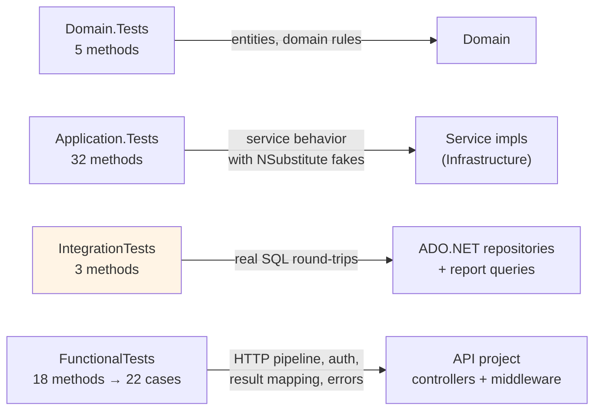

# Testing

Describes the four test projects exactly as they exist, how to run them, what
each one covers, and their environment dependencies. Results cited as
"observed" come from actual executed runs of the commands below on this
repository (latest full run both dates observed: 2026-10-21); anything not
executed is marked.

## Test projects at a glance

Coverage map — which project exercises which layer (arrows point at the code
under test, not at project references):



⚠️ The integration node is highlighted deliberately: those three tests open a
**real SQL Server connection** — when none is reachable they return early and
exercise **no** database code (see below). A green suite on a database-less
machine therefore proves nothing about the SQL layer.

| Project | Kind | Libraries (versions from csproj) | Needs live SQL Server? |
|---|---|---|---|
| `tests/LampFactory.Domain.Tests` | Unit — Domain rules | xunit 2.9.3, Test SDK 18.0.0 | No |
| `tests/LampFactory.Application.Tests` | Unit — service behavior with fakes | xunit, NSubstitute 5.3.0, FluentValidation.DI 12.1.1 | No |
| `tests/LampFactory.Infrastructure.IntegrationTests` | Integration — real ADO.NET repositories against SQL Server | xunit, Microsoft.Data.SqlClient 7.0.2 | **Yes — but skips itself when unreachable** |
| `tests/LampFactory.API.FunctionalTests` | Functional — full HTTP pipeline in memory | xunit, Microsoft.AspNetCore.Mvc.Testing 10.0.10 | Not for its assertions (see notes) |

Methods vs. executed cases: the counts in the left column are test methods.
Only the functional project contains a `[Theory]` (the 5-row
`ErrorType`→HTTP mapping); all other methods are single-case `[Fact]`s. So
the 18 functional methods become **17 facts + 5 theory cases = 22 executed
test cases**, which is what the runner reports.

## What each project covers

### Domain.Tests (5 test methods)

- `Inventory/WarehouseTests.cs` — warehouse-domain rules in the entity layer.
- `Production/ProductionPlanTests.cs` — production-plan entity rules.
No database, no HTTP, no mocking framework.

### Application.Tests (32 test methods)

- `Common/Results/ResultTests.cs` — `Result`/`Result<T>` factory methods and
  failure construction.
- `Inventory/WarehouseServiceTests.cs` — warehouse service paths.
- `Production/ProductionPlanServiceTests.cs`, `Production/BillOfMaterials/BOMServiceTests.cs` —
  plan and BOM service behavior, including the header/detail orchestration.
The service implementations exercised here live in
`LampFactory.Infrastructure` (that's why this project also has a project
reference to Infrastructure); their repository/token/current-user
dependencies are faked with **NSubstitute**. No SQL Server is touched — the
repositories are fakes.

### Infrastructure.IntegrationTests (3 test methods)

- `Persistence/WarehouseRepositoryTests.cs` — round-trips a warehouse with
  stock rows through the real `WarehouseRepository` and real SQL commands.
- `Reports/ProductionReportQueryTests.cs` — runs the real traceability report
  SQL.
- `Persistence/DatabaseFixture.cs` — resolves
  `ConnectionStrings:DefaultConnection` from (in order) `appsettings.json`,
  optional `appsettings.Test.json`, and environment variables; **opens a test
  connection once** and exposes `IsAvailable`.

**Skip condition (verified in the code):** every integration test begins with
`if (!_fixture.IsAvailable) return;` — on a machine without a reachable SQL
Server the suite reports the tests as passed-without-work rather than failing.
So "green" does not imply "database was tested"; provide a reachable
connection string (or `appsettings.Test.json` in the test project) to exercise
them for real.

### API.FunctionalTests (18 test methods → 22 executed test cases)

Shared factory `LampFactoryApiFactory` boots the real `Program` via
`WebApplicationFactory<Program>` and supplies **test-only** `Jwt:*` values in
code (never real secrets). Tests:

- `AuthenticationTests` — login with missing/empty credentials,
  anonymous access to a secured endpoint (401).
- `WarehouseEndpointsTests` — anonymous warehouse reads (401), unknown route
  (404).
- `ExceptionHandlingMiddlewareTests` — generic 500 without internal details,
  409 conflict mapping, 404 mapping.
- `ResultMappingTests` — unit-style checks of the result → HTTP mapping: a
  five-row `[Theory]` asserts that each `ErrorType` maps to its HTTP status
  (Validation→400, NotFound→404, Conflict→409, Unauthorized→401,
  Forbidden→403) **on both levels** — the transport status of the
  `ObjectResult` *and* the `statusCode` field inside the envelope — plus
  `isSuccess: false`, a non-empty `errorMessage`, and a `null` `result`;
  success cases assert `OkObjectResult` (200) with the payload preserved in
  `result`, a 200 success envelope without a payload for the non-generic
  `Result`, `NoContentResult` (204, no body) for deletes, and a 404 failure
  carrying its business message. The word "202" appears nowhere in the
  contract — these tests never assert 202.

These tests exercise the HTTP pipeline, authentication, and the error contract.
They do **not** seed or read business data; their negative paths resolve before
SQL access. They were observed passing on a machine with a reachable local
SQL Server; a strict no-database guarantee is **not** claimed here because the
real DI container does resolve the connection factory.

## How to run

```bash
# everything, from the repository root
dotnet test "Lamp Factory.slnx"

# one project at a time
dotnet test tests/LampFactory.Domain.Tests
dotnet test tests/LampFactory.Application.Tests
dotnet test tests/LampFactory.Infrastructure.IntegrationTests
dotnet test tests/LampFactory.API.FunctionalTests
```

Filtering examples: `dotnet test --filter "FullyQualifiedName~ResultMapping"`.

## Observed results (2026-10-21, full solution run)

| Project | Result |
|---|---|
| Domain.Tests | Passed 5 / 5 |
| Application.Tests | Passed 32 / 32 |
| IntegrationTests | Passed 3 / 3 (local SQL Server was reachable) |
| API.FunctionalTests | Passed 22 / 22 |
| **Total** | **62 / 62, 0 failed, 0 skipped** |

Restore/build during the same run emitted warnings only (none blocking):
`NU1900` (vulnerability-feed mirror unreachable), `NU1510` (redundant explicit
reference), and `NU1902`/`NU1903` — the transitive
`System.Security.Cryptography.Pkcs` `9.0.13` advisory chain from
`Microsoft.Data.SqlClient` `7.0.2` (details in
[development.md](development.md#6-common-problems)).

Earlier observation the same day: with an unset `Jwt:Key`, the 6 functional
tests that depend on valid JWT options failed with 500 responses until the
shared test factory supplied test-only values — evidence of how sensitive the
pipeline is to configuration (see [development.md](development.md#6-common-problems)).

## Interpreting results

- A **passing integration class** with an unreachable database is *vacuous* —
  check `DatabaseFixture.IsAvailable` / the test output if database coverage
  matters to you.
- Functional tests validate status codes and envelope shapes, not business
  data; business-level regression is covered by the Application unit tests
  and the integration tests (limited to warehouse + reports today).
- Coverage of the aggregate set is uneven by design so far: repositories have
  direct integration coverage only for warehouses and report queries.
